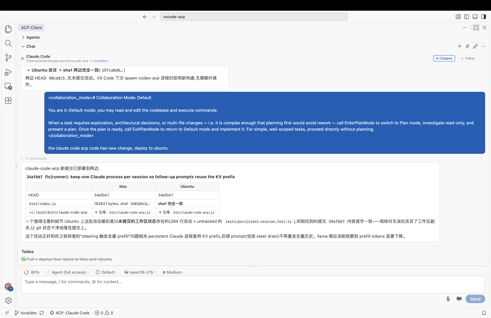

# ACP Client for VS Code

A [Visual Studio Code extension](https://marketplace.visualstudio.com/items?itemName=formulahendry.acp-client) that provides a client for the [Agent Client Protocol (ACP)](https://agentclientprotocol.com/) — connect to any ACP-compatible AI coding agent directly from your editor.



## Features

- **Multi-Agent Support**: Connect to 11 pre-configured ACP agents or add your own
- **Single-Agent Focus**: One agent active at a time — seamlessly switch between agents
- **Per-Agent Session List**: Each agent in the Agents view is expandable into its previous sessions. Click a session to restore its history in the chat. Backed by `session/list` when the agent supports it, or by a local per-workspace cache otherwise.
- **Session Config Options**: Dynamic per-session selectors (mode, model, reasoning level, …) advertised by the agent are rendered automatically in the composer toolbar.
- **Interactive Chat**: Built-in chat panel with Markdown rendering, inline tool call display, and collapsible tool sections
- **Thinking Display**: See agent reasoning in a collapsible block with streaming animation and elapsed time
- **Slash Commands**: Autocomplete popup for agent-provided commands with keyboard navigation
- **Mode & Model Picker**: Switch agent modes and models directly from the chat toolbar (kept for agents that haven't migrated to Session Config Options yet)
- **File System Integration**: Agents can read and write files in your workspace
- **Terminal Execution**: Agents can run commands with terminal output display
- **Permission Management**: Configurable auto-approve policies for agent actions
- **Protocol Traffic Logging**: Inspect all ACP JSON-RPC messages with request/response/notification labels
- **Voice Dictation**: Click the mic in the composer to dictate a prompt. Transcription runs against any OpenAI-style STT endpoint (`acp.voice.stt.endpoint`) — Whisper, a local whisper.cpp server, etc. Silence auto-stop and a Bluetooth "audio flowing" probe included; on Windows the built-in MCI recorder works with nothing to install.
- **Screen Recording → Video Vision**: Click 🖥 in the composer to record a display or window (extended screens included) as MP4. On send, the take is analyzed by a video-capable endpoint (StepFun-style `video_url`, `acp.vision.endpoint`) and the summary is injected into the prompt; with no endpoint configured, frames are extracted and attached as images for image-capable agents. See [docs/vision-models.md](docs/vision-models.md) for the provider matrix.
- **Remote SSH / WSL / Containers**: Voice and screen capture run on the **client** machine via the `acp-local-capture` companion extension (`extensionKind: ["ui"]`), so both work when the extension host is a headless remote server. See [docs/voice-remote-ssh.md](docs/voice-remote-ssh.md) and [docs/vision-remote-ssh.md](docs/vision-remote-ssh.md).
- **Agent Registry**: Browse and discover available ACP agents
- **Chat Persistence**: Conversations are preserved when switching panels

## Quick Start

1. Install: [Visual Studio Code Marketplace](https://marketplace.visualstudio.com/items?itemName=formulahendry.acp-client) | [Open in VS Code](https://vscode.dev/redirect?url=vscode%3Aextension%2Fformulahendry.acp-client) | [Open VSX Marketplace](https://open-vsx.org/extension/formulahendry/acp-client)
2. Open the ACP Client panel from the Activity Bar (ACP icon)
3. Click **+** to add an agent configuration, or use the defaults
4. Click an agent to connect
5. Start chatting!

## Requirements

- Node.js 18+ (for spawning agent processes)
- An ACP-compatible agent installed or available via `npx`

## Pre-configured Agents

The extension comes with default configurations for:

| Agent | Command |
|-------|---------|
| GitHub Copilot | `npx @github/copilot-language-server@latest --acp` |
| Claude Code | `npx @agentclientprotocol/claude-agent-acp@latest` |
| Gemini CLI | `npx @google/gemini-cli@latest --experimental-acp` |
| Qwen Code | `npx @qwen-code/qwen-code@latest --acp --experimental-skills` |
| Auggie CLI | `npx @augmentcode/auggie@latest --acp` |
| Qoder CLI | `npx @qoder-ai/qodercli@latest --acp` |
| Codex CLI | `npx @zed-industries/codex-acp@latest` |
| OpenCode | `npx opencode-ai@latest acp` |
| OpenClaw | `npx openclaw acp` |
| [Kiro CLI](https://kiro.dev/docs/cli/acp/) | `kiro-cli acp` |
| [Hermes Agent](https://hermes-agent.nousresearch.com/docs/user-guide/features/acp) | `hermes acp` |

You can add custom agent configurations in settings.

> **Note on Hermes Agent**: Hermes is a Python package, not an npm package. Install it via the [Hermes Quickstart](https://hermes-agent.nousresearch.com/docs/getting-started/quickstart) (Linux/macOS/WSL2 only — Windows requires [WSL2](https://learn.microsoft.com/en-us/windows/wsl/install)). Make sure `hermes` is on your `PATH` and launch VS Code from the same shell/venv. Configure credentials with `hermes model`.

## Extension Settings

| Setting | Default | Description |
|---------|---------|-------------|
| `acp.agents` | *(11 agents)* | Agent configurations. Each key is the agent name, value has `command`, `args`, and `env`. |
| `acp.autoApprovePermissions` | `ask` | How agent permission requests are handled: `ask` or `allowAll`. |
| `acp.defaultWorkingDirectory` | `""` | Default working directory for agent sessions. Empty uses current workspace. |
| `acp.logTraffic` | `true` | Log all ACP protocol traffic to the ACP Traffic output channel. |
| `acp.logTrafficMaxEntries` | `1000` | Maximum entries kept in the ACP Traffic output channel before it is cleared. Bounds memory in long sessions. |

### Voice dictation

| Setting | Default | Description |
|---------|---------|-------------|
| `acp.voice.enabled` | `true` | Master switch for the mic button. |
| `acp.voice.stt.endpoint` | `""` | OpenAI-style STT endpoint (`POST /v1/audio/transcriptions`). Empty disables dictation. |
| `acp.voice.stt.apiKey` | `""` | API key for the STT endpoint. |
| `acp.voice.stt.model` | `""` | Model name sent to the STT endpoint. |
| `acp.voice.stt.language` | `""` | Language hint passed to the STT endpoint. |
| `acp.voice.stt.prompt` | `""` | Prompt/context passed to the STT endpoint. |
| `acp.voice.stt.timeoutMs` | `60000` | STT request timeout. |
| `acp.voice.captureMode` | `auto` | `auto` uses the companion in remote windows, the extension host locally. `localCompanion` forces the companion, `extensionHost` forces local. |
| `acp.voice.recordCommand` | `""` | Override the recorder binary (resolved on the machine that captures). |
| `acp.voice.windowsRecorder` | `auto` | Windows backend: `auto` picks MCI when no recorder binary is on PATH, `mci` forces the built-in recorder, `binary` forces SoX/ffmpeg. |
| `acp.voice.maxDurationSec` | `120` | Dictation take length cap. |
| `acp.voice.silenceAutoStopSec` | `2.5` | Stop the take after this many seconds of silence (SoX backend only; 0 disables). |
| `acp.voice.silenceThresholdPct` | `3` | Silence threshold for auto-stop, percent of full scale. |
| `acp.voice.autoSend` | `false` | Send the transcribed prompt immediately instead of leaving it in the composer. |
| `acp.voice.keepTakes` | `failed` | Which WAV takes to keep on disk: `all`, `failed`, or `none`. |
| `acp.voice.corrections` | `{}` | Voice Memory corrections applied to transcripts (e.g. homophone fixes). |
| `acp.voice.corrector.enabled` | `false` | Run an LLM pass over the transcript before it lands in the composer. |
| `acp.voice.corrector.endpoint` | `http://127.0.0.1:11434/v1/chat/completions` | OpenAI-compatible endpoint for the corrector pass (defaults to a local Ollama). |
| `acp.voice.corrector.model` | `qwen2.5:7b` | Corrector model name. |
| `acp.voice.corrector.apiKey` | `""` | Corrector API key. |
| `acp.voice.corrector.timeoutMs` | `15000` | Corrector request timeout. |
| `acp.voice.memoryFile` | `""` | Path to the Voice Memory file (learned corrections). |

### Screen recording / video vision

| Setting | Default | Description |
|---------|---------|-------------|
| `acp.vision.enabled` | `true` | Master switch for the 🖥 screen-record button. |
| `acp.vision.endpoint` | `https://api.stepfun.com/v1` | OpenAI-compatible video-vision endpoint. Empty falls back to frame extraction for image-capable agents. |
| `acp.vision.apiKey` | `""` | API key for the vision endpoint. |
| `acp.vision.model` | `step-5-preview` | Video model name. |
| `acp.vision.provider` | `openai-compat` | Provider hint controlling payload shape (`openai-compat`, `stepfun`, …). |
| `acp.vision.prompt` | *(summary prompt)* | Instruction sent with the video. |
| `acp.vision.timeoutMs` | `180000` | Vision API timeout. |
| `acp.vision.inlineMaxBytes` | `15728640` | MP4s larger than this go through the provider's Files API instead of a base64 data URI. |
| `acp.vision.maxDurationSec` | `90` | Screen take length cap. |
| `acp.vision.ffmpegPath` | `""` | ffmpeg binary when it is not on PATH (resolved on the machine that captures). |
| `acp.vision.maxFrames` | `8` | Frames extracted in the no-endpoint fallback. |

## Commands

All commands are accessible via the Command Palette (`Ctrl+Shift+P`):

| Command | Description |
|---------|-------------|
| `ACP: Connect to Agent` | Connect to an agent |
| `ACP: New Conversation` | Start a new conversation with the connected agent |
| `ACP: Send Prompt` | Send a message to the agent |
| `ACP: Cancel Current Turn` | Cancel the current agent turn |
| `ACP: Disconnect Agent` | Disconnect from the current agent |
| `ACP: Restart Agent` | Restart the current agent process |
| `ACP: Open Chat Panel` | Focus the chat webview |
| `ACP: Add Agent Configuration` | Add a new agent to settings |
| `ACP: Remove Agent` | Remove an agent configuration |
| `ACP: Set Agent Mode` | Change the agent's operating mode |
| `ACP: Set Agent Model` | Change the agent's model |
| `ACP: Refresh Sessions` | Re-fetch the session list for an agent (also on the agent's right-click menu) |
| `ACP: Show Log` | Open the ACP Client log output channel |
| `ACP: Show Protocol Traffic` | Open the ACP Traffic output channel |
| `ACP: Browse Agent Registry` | Browse the ACP agent registry |

## Keyboard Shortcuts

| Shortcut | Action |
|----------|--------|
| `Ctrl+Shift+A` (`Cmd+Shift+A` on Mac) | Open Chat Panel |
| `Escape` (when turn in progress) | Cancel Current Turn |

## Development

### Prerequisites

- Node.js 18+
- VS Code 1.85+

### Setup

```bash
git clone https://github.com/formulahendry/vscode-acp.git
cd vscode-acp
npm install
```

### Build & Run

```bash
npm run compile    # One-time build
npm run watch      # Watch mode for development
```

Press `F5` in VS Code to launch the Extension Development Host.

### Testing

```bash
npm run pretest    # Compile tests + lint
npm test           # Run tests
```

### Packaging

```bash
npm run package    # Production build
npx @vscode/vsce package   # Create .vsix
```

## Architecture

The extension follows a modular architecture:

- **Core**: `AgentManager`, `ConnectionManager`, `SessionManager`, `AcpClientImpl`
- **Handlers**: `FileSystemHandler`, `TerminalHandler`, `PermissionHandler`, `SessionUpdateHandler`
- **UI**: `SessionTreeProvider`, `ChatWebviewProvider`, `StatusBarManager`
- **Config**: `AgentConfig`, `RegistryClient`
- **Utils**: `Logger`, `StreamAdapter`

Communication with agents uses the ACP protocol (JSON-RPC 2.0 over stdio).

## Known Issues

- Agents must be available via the system PATH or `npx`
- Some agents may require additional authentication setup
- Image attachment is only shown when the current model supports image input. For Codex CLI, this is determined from `~/.codex/model_catalog.json`. For Kiro CLI, Claude models are assumed to support images; all others (minimax, qwen, glm, kimi) are text-only. Clipboard paste of images is also gated by this check.

## Links

- [ACP Client on Visual Studio Code Marketplace](https://marketplace.visualstudio.com/items?itemName=formulahendry.acp-client)
- [Agent Client Protocol](https://agentclientprotocol.com/)
- [GitHub Repository](https://github.com/formulahendry/vscode-acp)

## Related Projects

- [ACP UI](https://github.com/formulahendry/acp-ui) — A modern, cross-platform desktop client for the Agent Client Protocol (ACP)
- [WeChat ACP](https://github.com/formulahendry/wechat-acp) — Bridge WeChat chat messages to any ACP-compatible AI agent (Claude, Codex, Copilot, Qwen, Gemini, OpenCode and more)

## License

MIT — see [LICENSE](LICENSE) for details.
